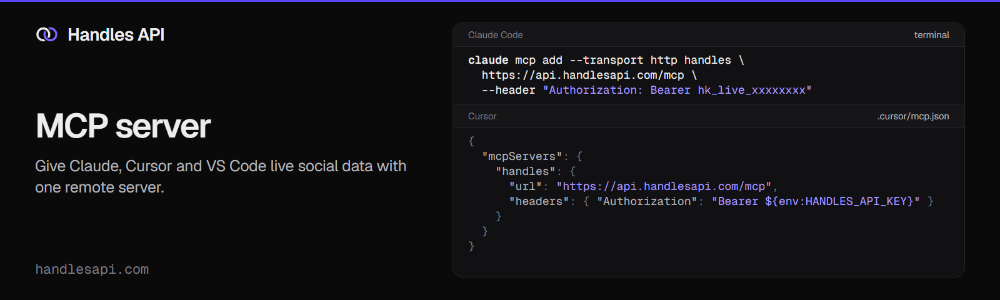
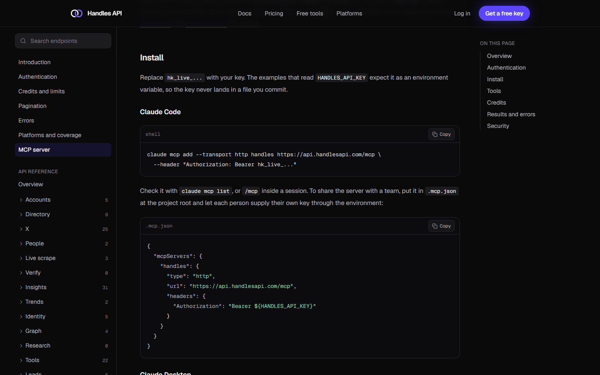

# Handles API MCP server

[](https://glama.ai/mcp/connectors/io.github.handlesapi/mcp)

The Handles API MCP server gives Claude, Cursor, VS Code and any other [Model Context Protocol](https://modelcontextprotocol.io) client direct access to public data from X (Twitter), Instagram, TikTok, YouTube, Telegram, Bluesky, Twitch, Kick and LinkedIn companies. It is one hosted remote server, `https://api.handlesapi.com/mcp`, that you authenticate with your own [Handles API](https://handlesapi.com) key and that spends the same credits as the REST API. This repository holds ready-to-copy configuration for each client, the tool list, and small scripts for calling the server by hand.

Nothing here needs installing: the server is remote (Streamable HTTP, one `POST` per call, no session).

## Why

- One hosted server instead of a scraper per platform: your assistant gets X, Instagram, TikTok, YouTube, Telegram, Bluesky, Twitch, Kick and LinkedIn company data through one set of tools.
- A short list on purpose: 21 curated tools cover the common questions, and `handles_request` plus `handles_list_endpoints` reach the rest of the catalog.
- Same key, same credits and same error envelope as the REST API; every tool is read-only.

## Quickstart

1. Get an API key at [handlesapi.com/signup](https://handlesapi.com/signup). The Free plan gives you 100 credits to try every endpoint, once, with no card.
2. Export it: `export HANDLES_API_KEY=hk_live_...`
3. Add the server to your client (below), then ask: "How many subscribers does MrBeast have on YouTube?"

Server URL: `https://api.handlesapi.com/mcp`. Authentication: `Authorization: Bearer <key>` (or an `x-api-key` header), exactly as for the REST API.

## Configure your client

Every file in [`configs/`](configs) is copy-paste ready.

### Claude Code

```bash
claude mcp add --transport http handles https://api.handlesapi.com/mcp \
  --header "Authorization: Bearer $HANDLES_API_KEY"
```

Check it with `claude mcp list`, or `/mcp` inside a session. To share the server with a team, commit [`configs/claude-code.mcp.json`](configs/claude-code.mcp.json) as `.mcp.json` at the project root; each person supplies their own key through the environment.

### Claude Desktop

Add [`configs/claude-desktop.json`](configs/claude-desktop.json) to `claude_desktop_config.json` (Settings, Developer, Edit Config). It uses [`mcp-remote`](https://www.npmjs.com/package/mcp-remote) to bridge Claude Desktop to the remote server and adds the header. The key goes in `env`; the header argument has no space after the colon because some Windows versions mangle spaces inside `args`.

### Cursor

Save [`configs/cursor.json`](configs/cursor.json) as `~/.cursor/mcp.json` (all projects) or `.cursor/mcp.json` (one project). Cursor resolves `${env:HANDLES_API_KEY}` from your environment.

### VS Code

Save [`configs/vscode.json`](configs/vscode.json) as `.vscode/mcp.json` in the workspace. VS Code prompts for the key the first time the server starts and stores it securely, so it never sits in a file.

### Any other client

Any client that speaks Streamable HTTP and can send a custom header works: point it at `https://api.handlesapi.com/mcp` and set `Authorization: Bearer <key>`.

## Tools and endpoints

The server exposes 23 tools, not one per endpoint: a short list keeps the assistant's context small and its choices accurate. Every tool name starts with `handles_`. Arguments follow the REST parameters of the same endpoint; the full list for each is in the [API reference](https://handlesapi.com/docs/reference). A machine-readable snapshot with input schemas is in [`tools.json`](tools.json).

| Tool | Endpoint | Credits | What it does |
| --- | --- | --- | --- |
| `handles_check_account` | `GET /accounts/{platform}/{handle}` | 1 | Check one account against the catalog: identity, audience, verification, data age. |
| `handles_directory_list` | `GET /directory/{platform}` | 1 | List or search one platform's catalog with filters, sorting and cursors. |
| `handles_directory_get` | `GET /directory/{platform}/{id}` | 1 | Full record of one account, by handle or platform id. |
| `handles_directory_growth` | `GET /directory/{platform}/{id}/growth` | 1 | Daily audience history of one account, up to 365 days. |
| `handles_directory_search` | `GET /directory/search` | 1 | Search by handle or name across several platforms at once. |
| `handles_people_lookup` | `GET /people/lookup` | 1 | Find a handle on every platform, with the evidence it is the same owner. |
| `handles_people_search` | `GET /people/search` | 1 | Find accounts by audience size, engagement, language, category and verification. |
| `handles_identity_graph` | `GET /identity/graph` | 1 | A company's accounts across networks, from a handle, a domain or a LinkedIn slug. |
| `handles_x_user` | `GET /x/users/{handle}` | 2 (live read) | Live X profile, as X reports it right now. |
| `handles_x_user_tweets` | `GET /x/users/{handle}/tweets` | 2 (live read) | Live X timeline with engagement counts. |
| `handles_x_search_tweets` | `GET /x/search/tweets` | 2 (live read) | Live X search with advanced-search syntax. |
| `handles_x_user_followers` | `GET /x/users/{handle}/followers` | 2 (live read) | Live list of an X account's followers. |
| `handles_insights_x_account` | `GET /insights/x/{handle}` | 1 | One-call dossier on an X account: engagement, volume, best posts, peer benchmark. |
| `handles_x_top_tweets` | `GET /insights/x/{handle}/top-tweets` | 1 | An X account's best-performing posts. |
| `handles_instagram_top_posts` | `GET /insights/instagram/{handle}/top-posts` | 1 | An Instagram account's best posts with measured likes, comments and views. |
| `handles_instagram_content_mix` | `GET /insights/instagram/{handle}/content-mix` | 1 | Which format works on an Instagram account: reels, carousels or images. |
| `handles_trends_movers` | `GET /trends/{platform}/movers` | 1 | Accounts that gained or lost the most audience on the freshest day. |
| `handles_tool_valuation` | `POST /tools/valuation` | 2 (live read) | Dollar estimate of an X account, as a low, expected and high range. |
| `handles_tool_engagement_calculator` | `POST /tools/engagement-calculator` | 2 (live read) | True engagement rate of an X account from its recent posts. |
| `handles_linkedin_companies` | `GET /leads/linkedin/companies` | 1 | Search LinkedIn companies by country, industry, size and contactability. |
| `handles_linkedin_company` | `GET /leads/linkedin/companies/{id}` | 1 | One LinkedIn company with socials, contacts and decision makers. |
| `handles_request` | any sold endpoint | as the endpoint | Call any endpoint in the catalog by method, path, query and body. A path that is not sold is refused. |
| `handles_list_endpoints` | none | 0 | Lists every sold endpoint by tag with its credit cost. Use it to find what to pass to `handles_request`. |

The platform argument accepts `x`, `instagram`, `tiktok`, `youtube`, `telegram`, `bluesky`, `twitch` and `kick` where the endpoint covers them; LinkedIn companies have their own tools.

## Pricing and credits

Catalog, insights, identity and lead reads cost 1 credit; live reads cost 2. Plans: Free (100 credits, once, no card), Starter ($29 a month, 15,000 credits), Pro ($99, 75,000), Business ($299, 300,000), Scale ($799, 1,200,000). See [Credits and limits](https://handlesapi.com/docs/credits-and-limits) and [pricing](https://handlesapi.com/pricing).

A tool call costs exactly what the endpoint behind it costs: 1 credit for catalog reads and insights, 2 for live reads. There is no surcharge for MCP, and listing tools or endpoints is free. Every successful result ends with a line such as `Credits: 1 spent, 14999 remaining this period.`, so the assistant can see what a session has used. See [Credits and limits](https://handlesapi.com/docs/credits-and-limits) and [pricing](https://handlesapi.com/pricing).

## Call it by hand

```bash
./scripts/list-tools.sh
./scripts/call-tool.sh handles_check_account '{"platform":"youtube","handle":"mrbeast"}'
```

The same call with plain `curl`:

```bash
curl https://api.handlesapi.com/mcp \
  -H "Authorization: Bearer $HANDLES_API_KEY" \
  -H "Content-Type: application/json" \
  -d '{
    "jsonrpc": "2.0",
    "id": 1,
    "method": "tools/call",
    "params": {
      "name": "handles_check_account",
      "arguments": { "platform": "x", "handle": "nasa" }
    }
  }'
```

A successful call returns the JSON body of the endpoint as text, followed by the credits line. A failed call returns `isError: true` with the status, error code and message from the [error envelope](https://handlesapi.com/docs/errors).

## About the protocol



The Model Context Protocol is an open standard that lets assistants call tools exposed by a server. This server speaks Streamable HTTP with JSON-RPC 2.0 (protocol versions 2024-11-05 through 2025-11-25) and supports `initialize`, `tools/list` and `tools/call`. See [modelcontextprotocol.io](https://modelcontextprotocol.io) and the [MCP docs](https://handlesapi.com/docs/mcp).

## Security

Anything the assistant can call, it can call repeatedly, and it spends your credits. Use a key with only the scopes you want it to have, keep overage off if you want a hard stop, and revoke the key in the dashboard when you are done. The key stays in your own configuration and is sent straight to the server in a request header; it is never part of a tool argument, so it does not enter the conversation. Every tool is read-only: they query public social data and change nothing on any account.

## Links

- Documentation: [handlesapi.com/docs/mcp](https://handlesapi.com/docs/mcp)
- Authentication and scopes: [handlesapi.com/docs/authentication](https://handlesapi.com/docs/authentication)
- API reference: [handlesapi.com/docs/reference](https://handlesapi.com/docs/reference)
- OpenAPI spec: [handlesapi/openapi](https://github.com/handlesapi/openapi)
- TypeScript client: [handlesapi-js](https://github.com/handlesapi/handlesapi-js)
- Python client: [handlesapi-python](https://github.com/handlesapi/handlesapi-python)
- Examples: [handlesapi/examples](https://github.com/handlesapi/examples)
- Pricing: [handlesapi.com/pricing](https://handlesapi.com/pricing)
- Changelog: [CHANGELOG.md](CHANGELOG.md), contributing: [CONTRIBUTING.md](CONTRIBUTING.md), security: [SECURITY.md](SECURITY.md)

Handles API is an independent service and is not affiliated with any of the platforms it covers. It returns public data only. MIT licensed.
